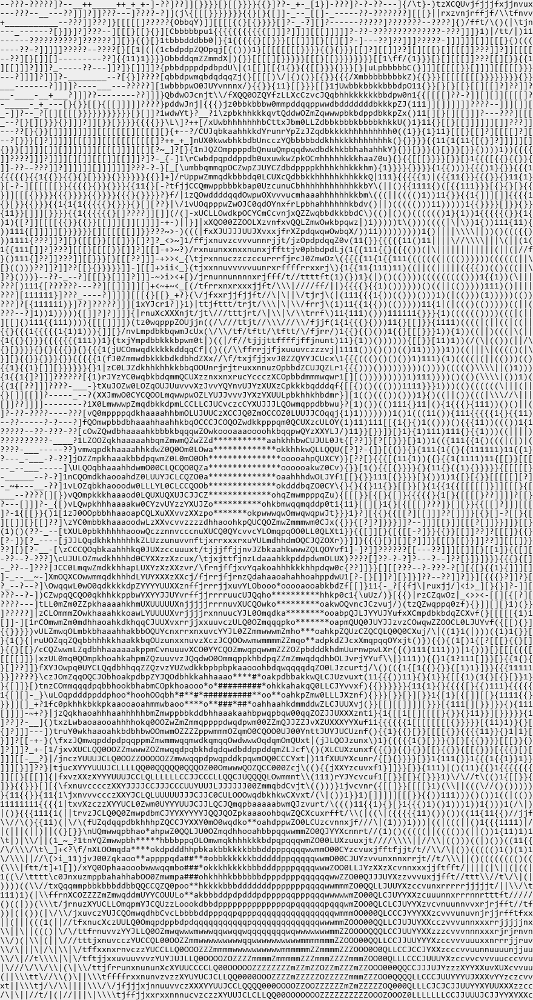
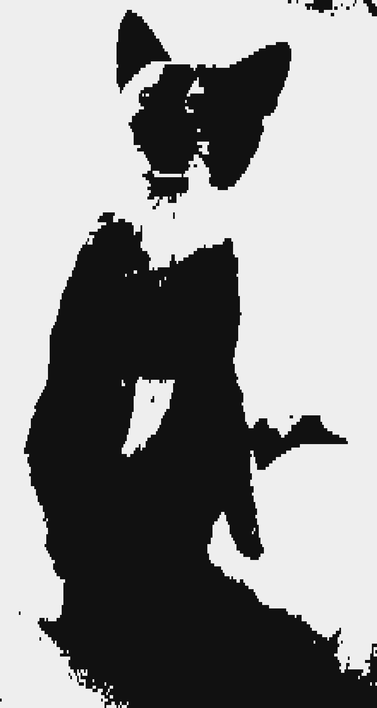
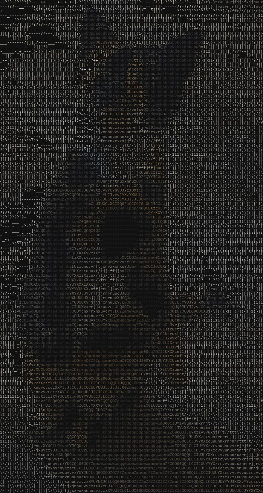
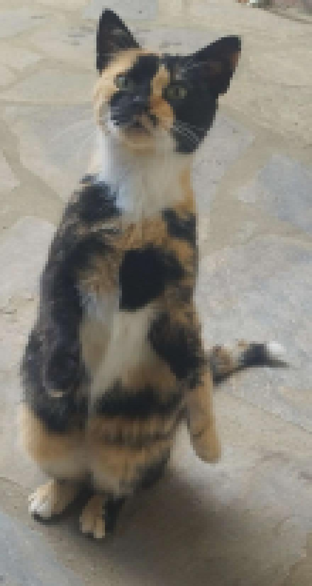
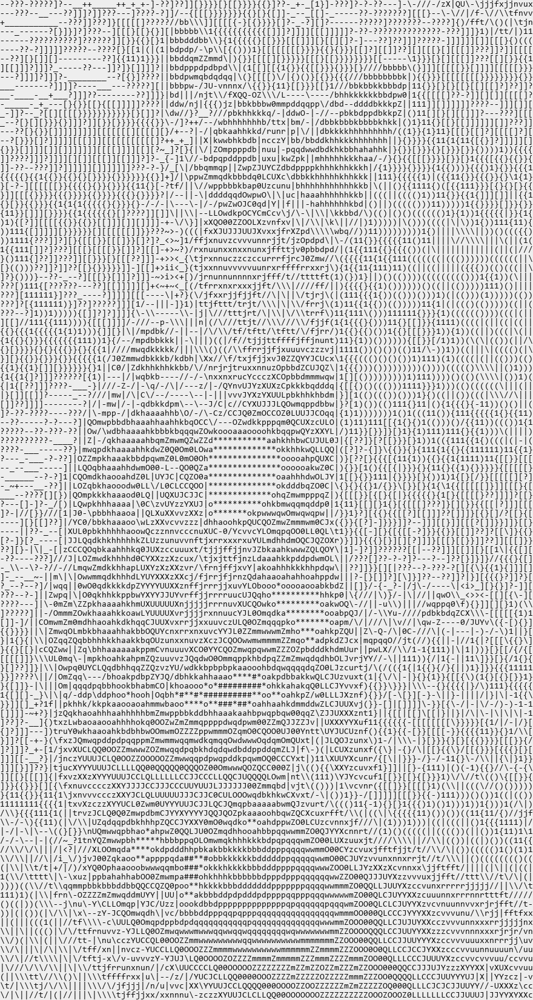

# Image_2_ASCII

**An Open-Source tool for converting images into ASCII representation, on the command line or in a window** 
 
## Disclaimer

- **⚠︎ This project is under development!**
- **⚠︎ Expect bugs and breaking changes.**
  
 This source code is licensed under the BSD-style license found in the **[LICENSE](LICENSE)** file in the root directory of this Repository.

## How to run

**Python 3.10 or newer.** The full test suite passes on 3.14, 3.12 and 3.10. Dependencies
are given as minimum versions rather than exact pins, so pip picks whichever release suits
the interpreter you have.

You will need the packages mentioned in [requirements.txt](requirements.txt) in order to run this app. **If you already have the required packages, you can skip this section.** Otherwise, you can install them by running the following shell command
```sh
$ pip install -r requirements.txt
```

or if you want to setup a **virtual** enviroment to not pollute the **root** enviroment, you can run one of the following commands, depending on your Operating System.

First, create the virtual enviroment

```sh
$ python -m venv venv/<name>
```
Then, activate it using the appropriate command, depending on your OS:

##### Windows
```sh
$ ./venv/<name>/Scripts/Activate
```

##### Linux
```sh
$ source venv/<name>/bin/activate
```

\
When that's completed, run the shell command
```sh
$ pip install -r requirements.txt
```

## The windowed version

Everything below can also be done by clicking in a GUI, with the source and the result side by side.
Nothing is written to disk until you pick a destination, so trying settings out costs nothing.

The window needs PySide6, which the command line version does not. Installing it does not
change how the command line version runs:

```sh
pip install -r requirements-gui.txt
```

```sh
python converter_gui.py
```

Every flag in the table below has a control. `--print` has no equivalent because the window does
the same job better and replaced by the result pane.

The log along the bottom prints the equivalent command line every time it converts, so the
window is never a black box: whatever it just did can be read, copied and run as-is.

PySide6 is used under the LGPL. It is a dependency of the windowed version only, and is not
part of this project's own BSD licensed source.

## Usage

This tool has a few features executed via command-line flags. In its simplest form, it analyses an image and splits it into a 2-Dimensional grid to then convert each slot into a grayscale format and assign an ASCII character to it from a given range.
You can always run the tool with the flag `-h` for info about each flag.

``` title="Usage command"
converter.py inputFile [-h] [-v] [-a] [-c] [-pix] [-i] [-e] [-p] [-d] [--alpha] [--frames]
                       [-wi INTEGER | -wc INTEGER]
                       [-hi INTEGER | -hc INTEGER]
                       [-gsc {10,70} (def: 70) | -gs STRING | -cs CHARSET]
                       [-th 0-255] [-et 0-100 (def: 90)] [-ca FLOAT (def: 0.5)]
                       [-g [auto|cupy|torch]]
                       [--maxframes INTEGER] [--framestep INTEGER] [--fps FLOAT]
                       [-op PATH] [-ot {txt, svg, png, jpg, xml, gif, mp4} (def: txt)]
                       [-on {CUSTOM, INPUT, RANDOM} (def: RANDOM)]
```

The quickest way to see something is to let it size itself and print straight to the terminal:

```sh
python converter.py myphoto.png -a -p
```

**[See the examples gallery](examples/README.md)** for what every flag actually looks like,
including all the character sets side by side.

### Explanation of the flags

| Flag   | Long Flag          | Description                                                                              | Value type                |
| :----- | :----------------- | :--------------------------------------------------------------------------------------- | :------------------------ |
| `-h`   | `--help`           | Displays a help message with more info.                                                  | Bool                      |
| `-v`   | `--version`        | Displays the current version of the app.                                                 | Bool                      |
| `-a`   | `--auto`           | Works out any tile counts you did not give, from the image shape and your terminal size. | Bool                      |
| `-c`   | `--colored`        | Output text will be colored instead of grayscale. Used for XML or image output formats.  | Bool                      |
| `-i`   | `--invert`         | Put the dense characters on the bright areas instead of the dark ones.                   | Bool                      |
| `-e`   | `--edges`          | Detect edges and draw them with directional characters ( \| / - \\ ).                    | Bool                      |
| `-et`  | `--edgethreshold`  | How much of the image becomes edges, as a percentile. Lower finds more.                  | 0-100                     |
| `-th`  | `--threshold`      | Collapse the image to two tones at this brightness cutoff.                               | 0-255                     |
| `-tb`  | `--thresholdband`  | Keep only the brightnesses between two values, erasing everything outside them.          | 0-255 0-255               |
| `-ca`  | `--charaspect`     | Character cell width divided by height, so output is not stretched.                      | Float                     |
| `-g`   | `--gpu`            | Run the maths on the GPU. Optional, see [GPU support](#gpu-support).                     | [auto, cupy, torch]       |
| `-wi`  | `--width`          | Custom tile Width in pixels.                                                             | Integer                   |
| `-wc`  | `--widthcount`     | Custom tile amount on the Horizontal axis (width).                                       | Integer                   |
| `-hi`  | `--height`         | Custom tile Height in pixels.                                                            | Integer                   |
| `-hc`  | `--heightcount`    | Custom tile amount on the Vertical axis (height).                                        | Integer                   |
| `-gsc` | `--grayscalecount` | Amount of descrete grayscale values. Possible values are 10 and 70.                      | [10, 70]                  |
| `-gs`  | `--grayscale`      | Your own character ramp, densest character first, e.g. `"@#+-. "`.                       | String                    |
| `-cs`  | `--charset`        | A built-in character set, see [Character sets](#character-sets).                          | See below                 |
| `-d`   | `--dither`         | Ordered dithering for the dot based character sets.                                      | Bool                      |
| `-pix` | `--pixelated`      | Convert the image into pixelart instead of ASCII.                                        | Bool                      |
|        | `--alpha`          | Flatten transparent areas onto black instead of ignoring the alpha channel.              | Bool                      |
| `-p`   | `--print`          | Write the result to the screen. Nothing is saved unless `-op` is also given.             | Bool                      |
|        | `--frames`         | Write each frame as a numbered file in a subfolder. See [Animation](#animation).          | Bool                      |
|        | `--maxframes`      | Stop after this many frames.                                                             | Integer                   |
|        | `--framestep`      | Keep only every Nth frame. Playback speed is preserved.                                  | Integer                   |
|        | `--fps`            | Override the output frame rate.                                                          | Float                     |
| `-op`  | `--outputfilepath` | The relative path of the output file                                                     | Path                      |
| `-ot`  | `--outputfiletype` | The format of the output file                                                            | [txt, jpg, png, xml, svg, gif, mp4] |
| `-on`  | `--name`           | The name method to use for the output file                                               | [CUSTOM, INPUT, RANDOM]   |

## Character sets

`-cs` picks how a cell becomes a character. Some are ordinary ramps; the rest split each
cell into a grid of dots and pack them into a single character, which is how you get several
times the resolution out of the same number of cells.

| Name | What it does | Resolution |
| :--- | :----------- | :--------- |
| `ascii70` | The default 70 character ASCII ramp | 1x |
| `ascii10` | A short 10 character ramp, coarser and higher contrast | 1x |
| `blocks` | Unicode shading blocks, `█▓▒░` | 1x |
| `shades` | Partial blocks, a longer ramp for smoother gradients | 1x |
| `quadrants` | The 16 quarter block characters, 2x2 dots per cell | 4x |
| `braille` | Braille dots, 2x4 per cell | 8x |
| `halfblocks` | `▀` with its own foreground and background colour. Use with `-c` | 2x, in colour |

The dot based sets ink the **dark** side of the image, matching the ramps where the heaviest
character goes on the darkest area. `-i` flips that, `-th` sets the cutoff explicitly, and
`-d` switches to ordered dithering, which carries tone rather than a flat silhouette but only
looks right at high tile counts. Combined with `-e`, a dot set inks edges instead of darkness,
which turns a photograph into line art.

> [!Note]
> Block and shading characters are drawn as exact rectangles rather than from a font, so they
> tile seamlessly and need no special font installed. Braille does need a font that has it:
> most fixed width fonts, including Consolas and Courier New, do not, so the tool looks for
> one that does and warns if it cannot find one. This only affects image output. Text output
> is just characters and always works.

## Animation

Animated GIF, WebP and APNG are read with **no extra dependency**, since Pillow already
handles them. There are four ways to write the result:

```sh
python converter.py clip.gif -a -wc 100 -ot gif -op out      # animated GIF
```
```sh
python converter.py clip.gif -a -wc 100 -p                   # play it in the terminal
```
```sh
python converter.py clip.gif -a -wc 100 --frames -op out     # one file per frame
```
```sh
python converter.py clip.gif -a -wc 100 -ot mp4 -op out      # re-encode as video
```

`--frames` creates a folder named `<output>_frames` next to your output path and writes
`frame_0001.txt` upward into it. It tells you the folder and the file count before writing
anything.

Long clips are a lot of work, so `--maxframes 30` is worth using while you settle on
settings. `--framestep 2` halves the frame count while keeping the playback speed the same.

### Video files

Video (mp4, mov, avi, webm, mkv) needs a decoder, which is **not** installed by default. The
tool tries PyAV, then imageio-ffmpeg, then an `ffmpeg` binary on your PATH, and tells you
what to install if it finds none:

```sh
pip install av
```

This is the same arrangement as `--gpu`: optional, never imported unless you actually convert
a video, and absent from `requirements.txt` so the base tool stays portable.

## GPU support

The `-g` / `--gpu` flag runs the tile averaging and edge detection on a graphics card.

**It is entirely optional and nothing about it is installed by default.** The tool needs
only the three packages in [requirements.txt](requirements.txt), all of which are plain pip
wheels, so it runs on any machine with Python on it. The GPU libraries are only imported if
you actually pass the flag, and if none is available the tool says so and carries on using
the CPU. Install one yourself if you want it:

```sh
pip install cupy-cuda12x
```

or a GPU build of PyTorch from [pytorch.org](https://pytorch.org/get-started/locally/).
CuPy needs an NVIDIA card; PyTorch also covers AMD (ROCm) and Apple silicon (MPS). Either
way the machine needs its vendor's driver, that part cannot be bundled by anyone.

> [!Note]
> **The GPU is not automatically faster.** Since version 1.1.0 the CPU converts a 3840x2160
> image to an 80,000 tile grid in about 0.11 seconds, and a small picture in a few
> milliseconds. Handing an image to a graphics card and reading the answer back is not free,
> so for anything small the transfer costs more than the work saved. Where `--gpu` should
> pay off is large images, and the heavier modes: `--edges` runs a Sobel pass over every
> pixel, which is by far the most expensive thing the tool does.
>
> These figures are CPU measurements. No GPU benchmark is published here because none has
> been run. The tool prints how long each conversion took, so measure both on your own
> machine and your own images rather than taking any of this on faith.

CPU and GPU results are the same picture. They are computed by different routes and can
disagree in about one cell in a hundred thousand, where a tile's brightness sits within
floating point noise of the boundary between two characters.

## Windows will warn about the downloads, and so may your antivirus

Both executables are unsigned, because a code signing certificate is not free. If this program gains traction, I may buy it. On a
freshly downloaded unsigned program Windows shows:

> **Windows protected your PC**. Microsoft Defender SmartScreen prevented an unrecognised
> app from starting.

**More info → Run anyway** starts it. The warning is about the *absence* of a paid
certificate and a download history, not about anything found in the file.

Some antivirus products go further and quarantine it outright. This is a known and
long-standing false positive affecting PyInstaller programs generally, not this one in
particular: a self-extracting executable that unpacks code and runs it resembles, in the
crude shape of the thing, what packed malware does. Nothing can be done about it from this
end short of paying for signing and building a reputation with each vendor.

If you would rather not take any of that on faith, **run it from source instead**. It is
the same code, and it needs only Python and `pip install -r requirements.txt`. You can also
build the executables yourself with the steps in the next section and compare.

## Building a standalone executable

There are two, built separately, so that the command line tool does not have to also package
a hundred megabytes of Qt, when it doesn't need it. Both run on a machine with no Python installed at all.

```sh
pip install -r requirements-dev.txt
```

**Command line only**. One file, about 28 MB, no interface code and no Qt in it:

```sh
pyinstaller Image2Ascii.spec --distpath builds/dist --workpath builds/work
```

**Windowed**. A folder of about 134 MB, zipped for release. Needs the GUI requirements as
well, and produces `Image2Ascii-GUI.exe` inside `builds/dist/Image2Ascii-GUI/`:

```sh
pyinstaller Image2AsciiGUI.spec --distpath builds/dist --workpath builds/work
```

The windowed build is a folder rather than a single file on purpose. Qt is LGPL, and shipping
it that way keeps the Qt libraries replaceable, which is what the licence asks for. It also
starts faster, since a one-file build unpacks its whole payload on every launch.

What each build leaves out, and why, is in [buildcommon.py](buildcommon.py).

Both are CPU only: a frozen build cannot see libraries installed on the host, so `--gpu`
inside either will always report that no GPU library is present and use the CPU.

## Development

Install the development requirements as above, then:

```sh
pytest
```

The conversion core is checked against the original tile-at-a-time implementation, which is
kept in [tests/reference.py](tests/reference.py) for exactly that purpose. The GPU code path
is exercised on any machine with PyTorch installed, GPU or not, because a CPU tensor runs
the identical code.

## Examples

The [examples gallery](examples/README.md) shows 24 runs covering every character set, effect
and output format, each with the exact command that produced it. Everything in it comes from
running the real tool, so it cannot drift out of date:

```sh
python examples/generate.py
```

| | | |
| :---: | :---: | :---: |
|  |  |  |
| default ASCII | `-cs braille` | `-cs quadrants` |
|  |  |  |
| `-c` | `-cs halfblocks -c` | `-e` |

## Roadmap

Previous releases are listed in [CHANGELOG.md](CHANGELOG.md).

ToDo List:

- [ ] Allow conversion from a URL.

Backlog / Potentially will never implement natively:

- [ ] Add slope support for grayscale-value control.

## Contribution

Found a bug? Or do you want to help improve this tool? Then please feel free to open a new **Issue** or submit a **Pull Request**!

> [!Important]
> Before you contribute read [CONTRIBUTING.md](CONTRIBUTING.md)

## Donate ♡

If you like this tool or the things I'm creating, please consider **Donating** using the **Kofi** link below or the link on the "Sponsor this project" section! This is NOT mandatory, but it helps out a lot and is greatly appreciated! **:)**\
You will also be added into my **Donation List** for everyone to see! (still in the works)\
(In case you choose to not have your username publicly displayed in the list mentioned above, please email me explicitly saying so in the email address linked in my profile, or saying so in the donation message.)

[](https://ko-fi.com/R6R7ZBM56)


