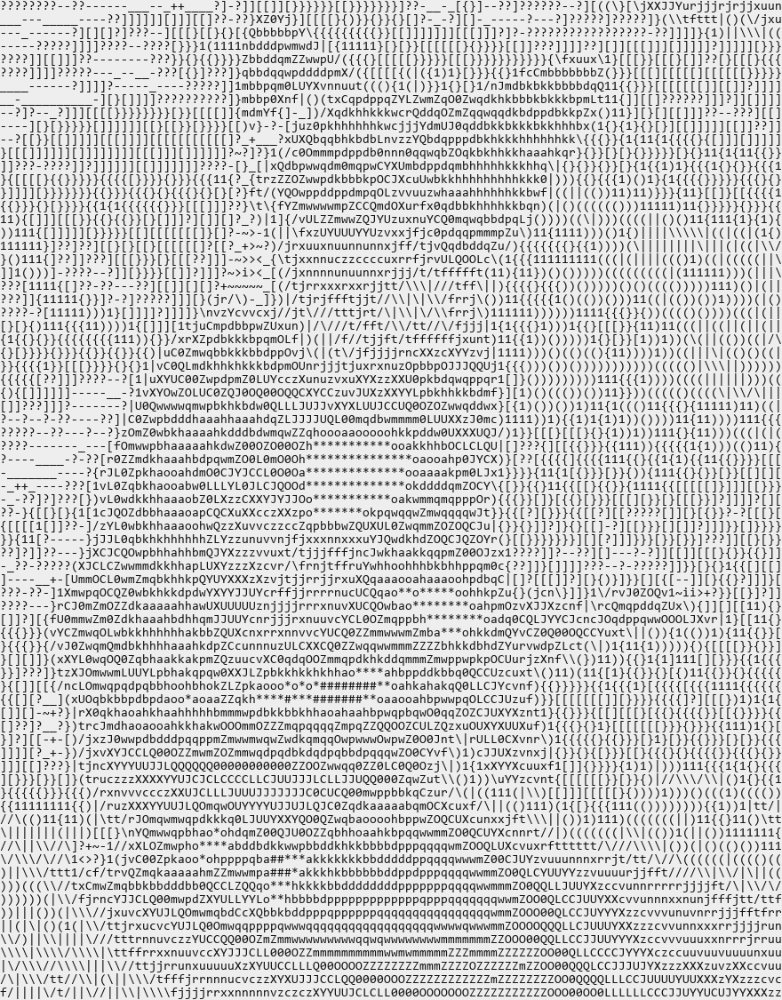
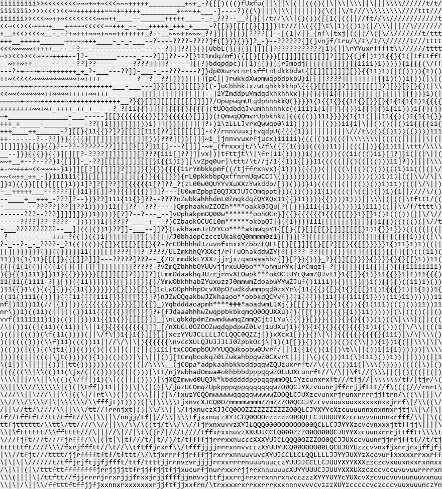
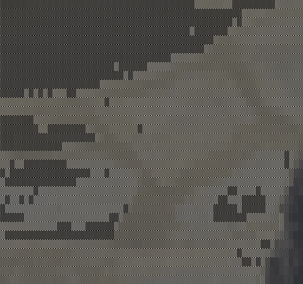

# Examples

Every image on this page is produced by [generate.py](generate.py), which runs the real
command line tool. Rebuild them all with:

```bash
py -3.12 examples/generate.py
```

The source photograph is [source/cat.jpg](source/cat.jpg). Most runs use a crop of it,
because the cat only occupies the middle of a fairly busy frame — the
[full frame example](#the-whole-photograph) shows the difference.

---

## The basics

### Default ASCII

No flags beyond the grid size. The 70 character ramp, dark areas getting the heaviest characters.

```bash
python converter.py examples/source/cat.jpg -wc 110 -hc 75 -ot png -op examples/output/basic
```



### Automatic sizing (`-a`)

Works the grid out from the image shape and the character aspect ratio, so the cat is not stretched. This is the quickest way to get a good result.

```bash
python converter.py examples/source/cat.jpg -a -wc 110 -ot png -op examples/output/auto
```


### The whole photograph

Every other example here is cropped to the cat. This is the full frame, to be honest about what a busy background looks like.

```bash
python converter.py examples/source/cat.jpg -a -wc 110 -ot png -op examples/output/full-frame
```



### Colour (`-c`)

Each cell keeps the average colour of the pixels underneath it.

```bash
python converter.py examples/source/cat.jpg -a -wc 110 -c -ot jpg -op examples/output/colored
```


## Character sets

### ascii10 (`-cs ascii10`)

A ten character ramp. Coarser and higher contrast than the default seventy.

```bash
python converter.py examples/source/cat.jpg -a -wc 110 -cs ascii10 -ot png -op examples/output/charset-ascii10
```


### blocks (`-cs blocks`)

Unicode shading blocks. Reads as a solid image rather than as text.

```bash
python converter.py examples/source/cat.jpg -a -wc 110 -cs blocks -ot png -op examples/output/charset-blocks
```


### shades (`-cs shades`)

Partial block characters, a longer ramp than `blocks` for smoother gradients.

```bash
python converter.py examples/source/cat.jpg -a -wc 110 -cs shades -ot png -op examples/output/charset-shades
```


### braille (`-cs braille`)

Each cell is a 2x4 grid of braille dots, so this is eight times the resolution of the same grid in ASCII. Dots go on the dark side, matching the ramps.

```bash
python converter.py examples/source/cat.jpg -a -wc 110 -cs braille -ot png -op examples/output/charset-braille
```


### braille with dithering (`-cs braille -d`)

The same run with ordered dithering. Dithering trades the clean silhouette for tone, and only earns its keep at high tile counts like this one.

```bash
python converter.py examples/source/cat.jpg -a -wc 170 -cs braille -d -ot png -op examples/output/charset-braille-dither
```


### quadrants (`-cs quadrants`)

Quadrant blocks, four times the resolution. Chunkier than braille and easier to read at small sizes.

```bash
python converter.py examples/source/cat.jpg -a -wc 110 -cs quadrants -ot png -op examples/output/charset-quadrants
```


### halfblocks in colour (`-cs halfblocks -c`)

The upper half block with a separate foreground and background colour, so one character carries two coloured pixels. Effectively a low resolution photograph.

```bash
python converter.py examples/source/cat.jpg -a -wc 110 -cs halfblocks -c -ot jpg -op examples/output/charset-halfblocks
```


## Effects

### Invert (`-i`)

Puts the heavy characters on the bright areas instead. Suits a dark background.

```bash
python converter.py examples/source/cat.jpg -a -wc 110 -i -ot png -op examples/output/invert
```


### Threshold (`-th 120`)

Two tones, split at the given brightness. Good for a stencil or sticker look.

```bash
python converter.py examples/source/cat.jpg -a -wc 110 -th 120 -ot png -op examples/output/threshold
```


### Edge detection (`-e`)

Sobel edges drawn with directional characters, over the usual ramp. The strongest tenth of the image becomes edges by default.

```bash
python converter.py examples/source/cat.jpg -a -wc 110 -e -ot png -op examples/output/edges
```


### More edges (`-e -et 70`)

Lowering the threshold finds more edges. At 70, the strongest thirty percent.

```bash
python converter.py examples/source/cat.jpg -a -wc 110 -e -et 70 -ot png -op examples/output/edges-strong
```


### Edges in braille (`-cs braille -e`)

With a dot based set, edge detection inks gradient strength instead of darkness, which turns the photograph into line art.

```bash
python converter.py examples/source/cat.jpg -a -wc 160 -cs braille -e -ot png -op examples/output/edges-braille
```


### A custom ramp (`-gs`)

Any string works as a ramp, densest character first.

```bash
python converter.py examples/source/cat.jpg -a -wc 110 -gs "@%#*+=-:. " -ot png -op examples/output/custom-ramp
```


### Pixel art (`-pix`)

Not ASCII at all: the image is shrunk to the grid and blown back up with hard edges.

```bash
python converter.py examples/source/cat.jpg -a -wc 90 -pix -c -ot jpg -op examples/output/pixelated
```


## Output formats

### Plain text (`-ot txt`)

The default. One character per cell, one line per row.

```bash
python converter.py examples/source/cat.jpg -a -wc 100 -ot txt -op examples/output/format-txt
```

[View the output file](output/format-txt.txt)

<details><summary>Show the first lines</summary>

```
-????-?????---__+_____+____-]-?]]?]][}}}}[}[}}}}}}}???-___]1}]--?]??????--?[(\/}?|rXX0Jcrfffjrrjxvux
---??--__---??]]]]]]]????]]??-??[jn\[[[[}}}}}{{{}}}[]?---_][]-_----?---??????][][1)trvxrrttj/||/txuv
____-____-?]][]]]???][[[[[]????-rdbbmu}[[[[}1{[}}}}}[]?--?][]??----???-?]???]]?-???-?]})\ttt/|)((|/j
--------??]????]???--][[}}[{1{{(pbbbbbmf1{1{{{1{}}[]]]][]][[[]?]]?-?]-????????????????]]?[[}1(\t//|(
----??-???]]]???--???][{}{(1{{1vbdddpqddc{}1{{{{}[}}{{[[[[[}{}}}[[]]?--?????][[[[[]??][]]]]?]]]][}}}
----?][[[[]?-------??][[[{11)(1Lbddq0CCZqL\((1)1}[[][[}[}[[[}}}}}}}}[[[[[}[]][][[[}[[[[]]???]]]]]}{{
]]][[][]]?-----???--??[{}}}[]?}qbbddppppppZ/)){[[[[[}}[}}}[[}}}}}}}}{|xYQmwwJ\{]][}[}}}}[]??}}}}}}}{
--??]]???]?-_-_____-??]{1[???]}qbbpwwqbdddpwu|{[[[[1\\)1)){[{}}{{}tYmbbbbbbkb/}}}[[[][[[[[[[[}[}}{}}
___-----??[]]]----___---?????]1qbbdpZOLCJzvvvf(}[}}11{}[[}[[[}1fYwbbbbkkbbbdd\1{{}}}[}[}}[[[[]?]?]]]
______--_+__-?]]??-------??]]]}0bdmQXvrf///xJCCQQCctYJXuXznuYCwbhkkkkkkbbdqZU1{}[[[[]???]]]][]][][]?
-_-____+_--?[}{}[[}{[[]]]]]??]{pdp0uf|{}{)xUqbkbbbw0Zwpdpwpqwqdppddddddkkbw0j111[][]]]]]]???-?]][[][
_-]]]?_?[[][[[}}}}}}}}}}}}}[]]{ZpQr{?++?(jQbbhhhhkwjfmdpOOZZwwwddbkbppdkkbwY((11}]}}[][]]]??-??-?][[
---?[}[[}}}}[]]?]]][}[}}}}}{{}}\c]-__1nXQpkhhhhhhdztfrZq0CQwddkkbbbkbkkhhkm()1}{1{}[[[[[]]]]][]]??]]
--?]?}{}[[]]][]]]][[[[[[[[[[[]]]__-?\LzXdpbhhhkbqvncvv0dQQZqdkkkkhhhhhhhhp\)1}}11{11{}}}}[[?]][[]??]
[][{}[]]]]]]]][[]][[[[[[][[[[]_~-_?]1UU0pZwdbdpb0ncvJLbbddbbdbkhkbkhhhhhkY}}}}}}}{{}1{}{{{)1{{{{}}}}
}[[?]][]][]]]]][][[[]]][]]]]]-~]]]1|tn0ZZmqddpdkwnxvpdmwkmQwkkhhhkkaaahb0{}}{[}[[{}}}[[}{}{{{{}1{}[}
?-----??]]]][[][[[[[[][]]????-[}_1tzqbdqwpdOZqqqLXzCdkpqdwOdhhhhhkkkhbt\}}}}}}}[}}{{{11}1111{}}}{{{1
{{{{{[}}}}[[}[}}[[[[[}[[[[[[}[]_]/uwdqmmmqpdpppq0LCUYCqbbkkhhhhhkhkkkL){1{}{1{}{)(){111{}{{{{}{{{{1{
}[???[[[[[}}}{{{}{}}{{}{{111{}-?tffYLQZwqdbbkbhbZJXvnnzqhhhhhhhhhkkkbC\(|(){}{111{)1}1111{}[}{}}}}{{
}]]][}}}}}{{{}}}{{{}{}{{}}}[}}?{f/)xQ0wpddpqdmmpm0zvcuuJkaaahhhhhhkbw/(((|((((11))11{}}{1{[]][]}1}{1
1}}}}{}}}{}1{1{1{{{{}{}}}}[]]??{\/(/XQqpqqwZqCCQwd0Xxrjcwbbhhhhhhkkdc()|()(((()))11))1)11{}}}}[}}{}{
{11}[[]][}}}{{{{{{}{}[]]??]?[[]?)/{-|cYJLZwbbwLYUZUvvxrY0ZmwdbdbbbdL\)(()|(((((((((){1{)11{{{{){}{1{
```

</details>

### SVG (`-ot svg`)

Vector output, so it stays sharp at any size. Runs of one colour share an element, which keeps the file reasonable.

```bash
python converter.py examples/source/cat.jpg -a -wc 80 -c -ot svg -op examples/output/format-svg
```


### XML (`-ot xml`)

Structured output for feeding into something else. Parses under any XML reader.

```bash
python converter.py examples/source/cat.jpg -a -wc 60 -ot xml -op examples/output/format-xml
```

[View the output file](output/format-xml.xml)

## Animation

Animated GIFs, WebP and APNG need no extra dependency at all. Video files need a
decoder installed; see the main [README](../README.md#animation).

```bash
python converter.py examples/source/cat.jpg -a -wc 64 -cs blocks -c -ot gif -op examples/output/animation
```



The same input can also be played straight in the terminal with `-p`, written as one
file per frame with `--frames`, or re-encoded to a video with `-ot mp4`.
